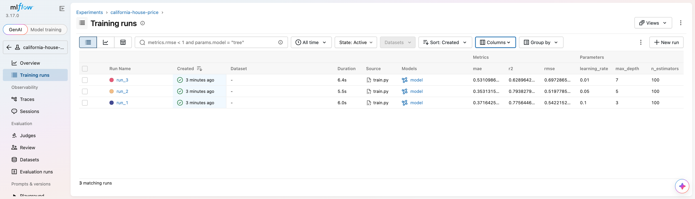
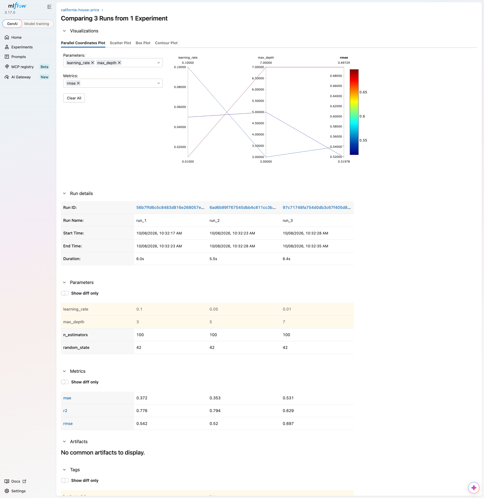
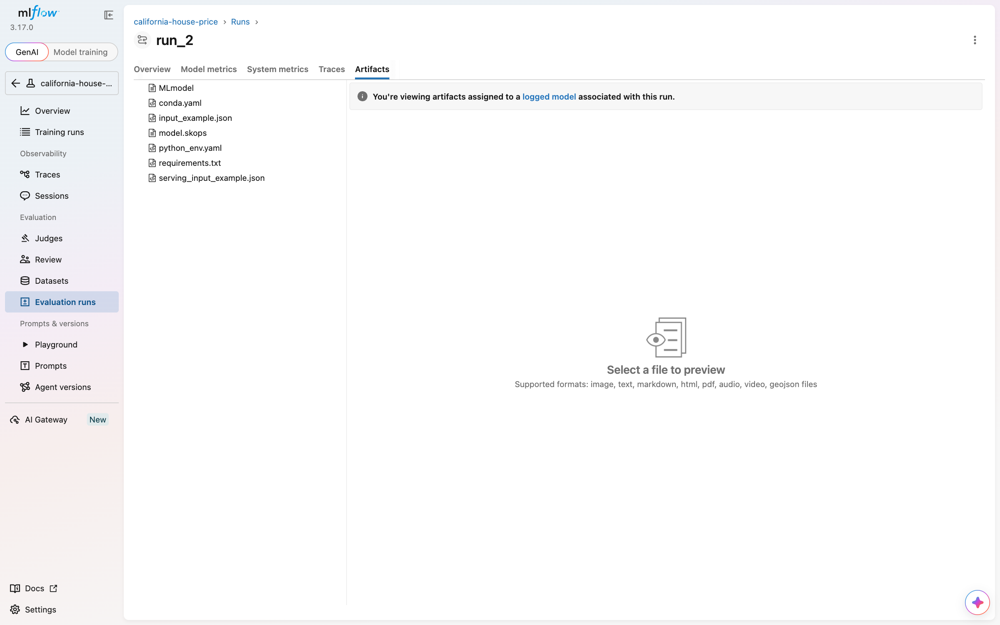

# California House Price: Experiment Tracking with MLflow

Train the same regression model three times with different hyperparameters, track every run in MLflow, compare the results, and pick the best model by validation RMSE.

```
Train  ->  Track  ->  Compare  ->  Select
```

## What it does

[`train.py`](train.py):

1. Loads the California Housing dataset from scikit-learn (20,640 districts, 8 features, target is median house value).
2. Splits it 80% training (16,512 rows) and 20% validation (4,128 rows) with a fixed random seed (42), so the split is the same every time.
3. Trains a `GradientBoostingRegressor` three times. Only `max_depth` and `learning_rate` change; the number of trees (100) and the seed are fixed so the runs are comparable.
4. For every run it logs to MLflow:
   - parameters: `max_depth`, `learning_rate` (plus `n_estimators` and `random_state` for completeness)
   - metrics on the validation set: RMSE, MAE, R²
   - the trained model, with its input and output signature, as an MLflow artifact
5. Compares the runs, prints a table, and tags the run with the lowest RMSE as `best_model`.

## Run it

```bash
pip install -r requirements.txt
python train.py
mlflow ui --backend-store-uri sqlite:///mlflow.db
```

Then open http://localhost:5000 and choose **Model training** at the top left, then **Training runs**. Tracking data is stored in `mlflow.db` and `mlruns/`, both created next to `train.py`.

Running `train.py` again adds three more runs to the same experiment. The numbers come out identical because the split and the models are seeded.

On a python.org Python for macOS, downloading the dataset can fail with `CERTIFICATE_VERIFY_FAILED`. Point Python at the certifi bundle and run again:

```bash
export SSL_CERT_FILE=$(python3 -c "import certifi; print(certifi.where())")
```

## Results

Training runs in the MLflow UI, with metrics and parameters as columns:



The three runs compared side by side, including the parallel coordinates plot of parameters against RMSE:



### Comparison

Primary metric: RMSE (lower is better), in units of $100,000.

| Run | Max Depth | Learning Rate | RMSE | MAE | R² |
|---|---|---|---|---|---|
| Run 1 | 3 | 0.1 | 0.5422 | 0.3716 | 0.7756 |
| **Run 2** | **5** | **0.05** | **0.5198** | **0.3531** | **0.7938** |
| Run 3 | 7 | 0.01 | 0.6973 | 0.5311 | 0.6290 |

### Best model: Run 2

`max_depth = 5`, `learning_rate = 0.05`, validation RMSE **0.5198**, which means a typical error of about $52,000 on a house price.

### Why Run 2

- It has the lowest RMSE, the metric used for selection. It beats Run 1 by about 4% and Run 3 by about 25%.
- It is also the best on MAE and R², so the choice does not depend on which metric you look at.
- Run 1 is a close second. Its trees are shallower (depth 3), so they cannot capture as many interactions between features as the depth 5 trees of Run 2.
- Run 3 is clearly worst even though its trees are the deepest. With a learning rate of only 0.01 and 100 trees, the model improves too slowly and stops early, so it underfits. A low learning rate normally needs many more trees.

Limits of this comparison: both hyperparameters change together between runs, so the results show which combination works best but not how much each one contributes on its own. The same validation set is used to choose and to report, so the final number is slightly optimistic. A held-out test set or cross validation would give a fairer estimate.

### The saved model

Each run stores its model as an MLflow artifact (`MLmodel`, `model.skops`, environment files and an input example). Reloading the best model and scoring the validation set reproduces the logged RMSE of 0.5198 exactly.



Load it from any run id:

```python
import mlflow
mlflow.set_tracking_uri("sqlite:///mlflow.db")
model = mlflow.sklearn.load_model("runs:/<run_id>/model")
```

## Notes

- MLflow 3 saves scikit-learn models with `skops`, which only accepts types it has been told to trust. `train.py` trusts the decision tree node type (`sklearn.tree._tree.Tree`), which is created by the script itself.
- Tested with MLflow 3.17.0, scikit-learn 1.9.0 and Python 3.13.
